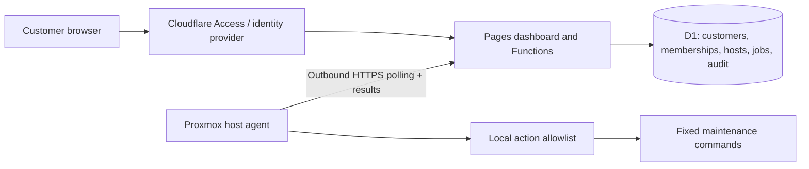

# ProxManager

An early multi-customer Proxmox VE management application for **Cloudflare Pages**, with Pages Functions, D1 storage, Cloudflare Access authentication and an outbound-only Python host agent. This is a working foundation, not a production security certification. No live servers have been modified.

## Included

- Customer-scoped inventory, memory/disk usage, load, uptime, Proxmox version and last-seen telemetry.
- Customer memberships: owners provision/revoke agents, operators request actions, viewers have read-only access.
- Reboot scheduling, package-index refresh, and package upgrades as fixed allowlisted actions.
- Per-host 256-bit credentials, stored as SHA-256 hashes in D1; credential displayed only at creation. To rotate, revoke the old registration and create a new one.
- Expiring queues, atomic dispatch, durable local receipts, result retry and customer-scoped audit events.
- Host-side opt-in policy. All remote actions are disabled on a fresh installation.

## Design



Cloudflare Access JWTs are cryptographically verified by the API, including issuer, audience and expiry. A verified email must also have a D1 membership for the requested customer. Customer IDs supplied by the browser are never treated as authorization. Each agent credential resolves to exactly one server. Proxmox API credentials are not stored in the cloud.

## Deploy to Cloudflare Pages

Prerequisites: Node.js 22+, Python 3.11+ for tests, a Cloudflare account with Pages, D1 and Access, and an HTTPS hostname for the app. No Sites hosting account is required.

1. Install development tooling: `npm install`. Authenticate using `npx wrangler login`.
2. Create storage: `npx wrangler d1 create proxmox-control`. Put the returned database ID in `wrangler.toml`.
3. Run migrations: `npx wrangler d1 migrations apply proxmox-control --remote`.
4. Create a Cloudflare Access self-hosted application for the dashboard hostname. Configure the identity provider, customer access policies and MFA at the provider. Set `ACCESS_TEAM` to `https://YOUR-TEAM.cloudflareaccess.com` and `ACCESS_AUD` to that application's audience, in `wrangler.toml` or Pages runtime variables.
5. The `/api/agent/*` paths must be reachable without interactive Access login. Create a more specific Access application for that path with a Bypass policy. These endpoints still require the application's per-host bearer credential. Keep the rest of the hostname behind the normal Access application. Test the path-specific configuration before installing an agent.
6. Provision customers and memberships using reviewed D1 SQL (below). There is no public signup or membership administration endpoint in this version.
7. Create the Pages project with `npx wrangler pages project create proxmox-control --production-branch main`, then run `npm run deploy`. The output folder is `public`; Functions are deployed from `functions`. Confirm the production D1 binding and variables in the Pages dashboard. Connect the protected hostname.
8. If using Git integration, connect this repository to Pages with build command left empty and output directory `public`. Verify bindings and variables for production separately from previews. Do not bind unprotected preview deployments to production storage.
9. Open the protected hostname, add a server, and follow **Agent setup**. Store the displayed token securely; it cannot be retrieved later.

Example customer provisioning, using D1's dashboard SQL console or a reviewed SQL file with `npx wrangler d1 execute proxmox-control --remote --file customer.sql`:

```sql
INSERT INTO tenants(id,name) VALUES('customer-unique-id','Example Customer');
INSERT INTO memberships(tenant_id,email,role)
VALUES('customer-unique-id','owner@example.com','owner');
-- Additional accounts: 'operator' or 'viewer'. Email must match Access identity.
```

Use unique opaque customer IDs and lowercase emails. Customer provisioning and changes to membership currently require an administrator with D1 access. Do not commit real customer email lists or agent configuration files.

## Agent installation

Copy the reviewed `agent` folder onto a Proxmox VE host (Python 3.11+), then as root:

```sh
sh agent/install.sh
editor /etc/proxmanager/config.json
chmod 600 /etc/proxmanager/config.json
systemctl enable --now proxmanager
journalctl -u proxmanager
```

Use the configuration shown by the dashboard. Leave `allowed_actions` empty to monitor only. To permit maintenance, explicitly add any of `refresh-updates`, `install-updates`, `reboot`, then restart the service. Use the final HTTPS origin; redirects are rejected to avoid leaking the credential.

The service runs as root because host package management and reboots need privilege. Its code, configuration and installation directory must remain root-owned and unwritable by untrusted users. Compromise of the cloud application, a customer owner/operator account, or the host credential is security-sensitive. The cloud can request any action that the local policy allows; this is not a sandbox against a compromised control plane. Splitting telemetry from a narrowly privileged local executor is a recommended next hardening step before a public production rollout.

`install-updates` runs `apt-get -y --no-remove upgrade`, using the host's configured repositories. It does not perform major release upgrades or a `dist-upgrade`. Package configuration may still require operator attention and a command can fail or time out. Check backups, repository configuration, cluster quorum/HA state and guest placement before enabling it. No automatic guest migration or maintenance sequencing is implemented.

## Delivery and failure behavior

- The agent polls every 20 seconds. A host is shown online when its last heartbeat is within 90 seconds. A long-running package action pauses its polling and can temporarily show it as offline.
- One queued/dispatched action per server. Jobs expire after two minutes if not dispatched. The agent checks expiry before execution.
- Dispatch is atomic and never automatically retried. A lost response may leave an action in `dispatched` even if it never ran. This deliberately avoids retrying an uncertain reboot or upgrade.
- A local SQLite receipt is committed before execution. Agent restart converts unfinished actions to `unknown` and never reruns them. Results retry until acknowledged. Retain `/var/lib/proxmanager` across upgrades.
- `succeeded` for reboot means the reboot was **scheduled**, not verified complete. Verify the host returns with a lower uptime.
- A dispatched action older than one hour can be acknowledged as unknown in Activity log after inspecting the host. This releases the queue but does not stop a still-running operation.
- Revocation blocks subsequent agent calls and cancels queued actions. A previously dispatched operation may still run. Treat the host as disconnected until its configuration is replaced.
- Audit entries record lifecycle events but are mutable by a database administrator. External immutable audit retention is not implemented.

## Validate locally

```sh
npm test
python -m unittest discover -s tests -p 'test_*.py'
```

API tests exercise real SQLite queries, signed JWT validation, tenant isolation, role restrictions, cross-origin rejection, command confirmation, dispatch, agent scoping and revocation. Agent tests use mocked execution; tests never reboot or update a machine. Set `TEST_PYTHON` if Python is not available as `python`.

`npm run dev` starts Wrangler's local Pages environment. Apply D1 migrations with `--local` first. Authentication remains enforced locally: real Access identity requires a protected hostname. There is no development authentication bypass.

## Before a customer production pilot

Complete an independent security review, Linux/Proxmox integration tests on disposable hosts, concurrent load tests on Cloudflare, customer onboarding/offboarding procedures, database backup/restore drills, and Cloudflare rate-limit policies for agent and user APIs. Add signed release distribution, agent version/upgrade policy, credential rotation UX, MFA/session policy and external audit retention. This foundation does not include billing, self-service signup, guest management, graphs/history, SSO per customer or automated cluster maintenance. Use a dedicated test deployment and test hosts first.

References: [Pages D1 bindings](https://developers.cloudflare.com/pages/functions/bindings/), [Cloudflare Access JWT validation](https://developers.cloudflare.com/cloudflare-one/access-controls/applications/http-apps/authorization-cookie/validating-json/), [Proxmox administration guide](https://pve.proxmox.com/pve-docs/pve-admin-guide.html).
